# Chain service architecture

How the chain service and its RPC provider stack fit together.

Everything here lives under `background/services/chain/`. Paths below are
relative to it.

## The parts

### Chain service

| Component                   | File                             | Owns                                                                                                                                                                                             |
| --------------------------- | -------------------------------- | ------------------------------------------------------------------------------------------------------------------------------------------------------------------------------------------------ |
| `ChainService`              | `index.ts`                       | The service facade and its event emitter. Builds the parts below, passes each the callbacks it needs, and keeps the list of tracked networks and accounts.                                       |
| `ProviderRegistry`          | `provider-registry.ts`           | One `chainMachine` actor per chain, keyed by decimal chain ID. The only place providers are created, replaced or destroyed.                                                                      |
| `chainMachine`              | `chain-machine.ts`               | One chain's provider, endpoint list and reachability, and the order in which endpoint updates and removal happen.                                                                                |
| `NetworkSettings`           | `network-settings.ts`            | Supported networks, custom chains, stored RPC endpoints, method-specific endpoints and block explorers. Checks new endpoints with `eth_chainId` before they are saved.                           |
| `NetworkWatcher`            | `network-watcher.ts`             | One `networkWatchMachine` actor per watched network, the watched accounts, and network and address activity times. Polls latest blocks and gas, and subscribes accounts to pending transactions. |
| `networkWatchMachine`       | `network-watch-machine.ts`       | When a network's block and gas polls run.                                                                                                                                                        |
| `TransactionTracker`        | `transaction-tracker.ts`         | The lookup queue and the steps that follow a transaction until it confirms, drops or expires.                                                                                                    |
| `pendingTransactionMachine` | `pending-transaction-machine.ts` | Pure decisions about a transaction's lifecycle, run as a transition function over the stored row.                                                                                                |
| `TransactionSubmitter`      | `transaction-submitter.ts`       | Populating requests, estimating gas, and broadcasting signed transactions.                                                                                                                       |
| `NonceAllocator`            | `nonce-allocator.ts`             | Nonces for outgoing transactions, per address and chain.                                                                                                                                         |
| `AssetTransferScanner`      | `asset-transfer-scanner.ts`      | Recent and historic asset transfer scans, which queue lookups for transactions they find.                                                                                                        |
| `NFTLogScanner`             | `nft-log-scanner.ts`             | With the NFT indexer on, paced ERC-721 log scans on the indexer's networks and their cursors.                                                                                                    |
| `AssetDataHelper`           | `asset-data-helper.ts`           | Token balances and transfers, from Alchemy methods or logs.                                                                                                                                      |
| `ChainDatabase`             | `db.ts`                          | IndexedDB: networks, endpoints, transactions, blocks, balances, NFT log scan cursors.                                                                                                            |

### RPC provider stack

| Component                    | File                               | Owns                                                                                                                                                                        |
| ---------------------------- | ---------------------------------- | --------------------------------------------------------------------------------------------------------------------------------------------------------------------------- |
| `SerialFallbackProvider`     | `serial-fallback-provider.ts`      | The ethers-compatible facade for one chain. Builds the endpoints and pools, routes requests, and holds the subscription manager, reachability tracker and lifecycle signal. |
| `RequestCache`               | `rpc/request-cache.ts`             | Known answers (`eth_chainId`), short-lived recent answers, and coalescing of identical requests in flight.                                                                  |
| Method router                | `rpc/method-router.ts`             | `routeRulesFor` and `ruleForMethod`: which pool a method goes to, and its fallback pool.                                                                                    |
| `FailoverExecutor`           | `rpc/failover-executor.ts`         | Walks a route's pools and their endpoints for one request, following a failure policy. All retry state lives in this loop.                                                  |
| Failure policies             | `rpc/failure-policy.ts`            | `standardFailurePolicy` and `anyErrorFailsOverPolicy`, and which errors are an endpoint's fault or an outage.                                                               |
| `EndpointPool`               | `rpc/endpoint-pool.ts`             | An ordered set of endpoints and which one requests start from, through `endpointPoolMachine` (`rpc/endpoint-pool-machine.ts`).                                              |
| `Endpoint`                   | `rpc/endpoint.ts`                  | One configured endpoint's lazily built transport and its health, through `endpointMachine` (`rpc/endpoint-machine.ts`).                                                     |
| `SubscriptionManager`        | `rpc/subscription-manager.ts`      | ethers listeners and `eth_subscribe` subscriptions, kept on one endpoint's transport and moved when told to.                                                                |
| Outcome observers            | `rpc/request-outcome-observers.ts` | Feed request outcomes to the reachability tracker, to performance metrics and to the log.                                                                                   |
| `NetworkReachabilityTracker` | `network-reachability.ts`          | Whether the chain can be reached at all, from exhausted walks and successes.                                                                                                |
| Endpoint configs             | `rpc/endpoint-configs.ts`          | Turns stored endpoints, Boar's URL, method-specific endpoints and fork overrides into `EndpointConfig`s.                                                                    |
| `TahoRPCProvider`            | `taho-rpc-provider.ts`             | The batching HTTP transport. Shrinks batches an endpoint finds too large and resends only the refused requests.                                                             |

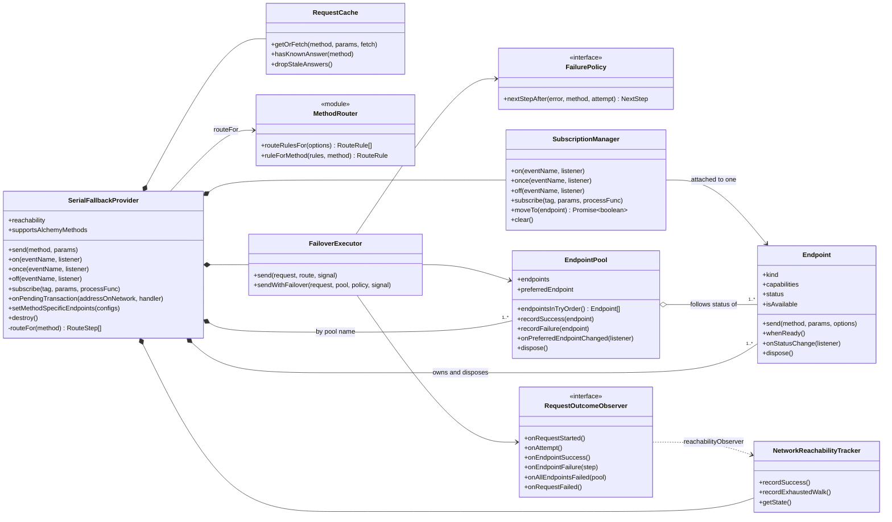

## Endpoints, pools and routes

A provider builds one `Endpoint` per configured endpoint. The walk's endpoints
are, in order, Boar (`managed`) when the chain has it, then the stored
endpoints (`standard`). Method-specific endpoints, such as Flashbots, sit
outside the walk.

Endpoints are shared between pools rather than owned by them; the provider
owns and disposes them. Each pool subscribes to its endpoints' status and
keeps its own preference. The pools are:

- `standard`: the whole walk.
- `managed`: Boar alone.
- `capability:<namespace>`: standard endpoints that declare a namespace, such
  as `alchemy_`.
- `methodSpecific`: the method-specific endpoints, replaced whole by
  `setMethodSpecificEndpoints`.

`routeRulesFor` turns these into rules, most specific first:
method-specific methods, then capability namespaces (falling back to
`managed` when Boar also serves the namespace), then methods pinned to Boar
(`eth_sendRawTransaction`, `eth_subscribe`, `eth_estimateGas`, `eth_getLogs`,
`alchemy_`, and `eth_call` on Optimism and Arbitrum), then the standard walk.
`standard` and `managed` use `standardFailurePolicy`; the others move on after
any error.

An endpoint is available while `Unbuilt`, `Connecting` or `Ready`.
`endpointsInTryOrder` starts from the pool's preferred endpoint, wraps
around, and skips unavailable endpoints. A pool whose only endpoint is
cooling down still tries it, as a probe, so Boar's methods aren't refused
outright while failures elsewhere have Boar cooling down. A pool of several
keeps skipping cooling endpoints, so the standard walk stays off a cooling
Boar.

`Endpoint.send` refuses requests with `NoEndpointAvailableError` while the
endpoint is cooling down or probing, unless they're probes, and waits for a
WebSocket that is still connecting.

### Endpoint health

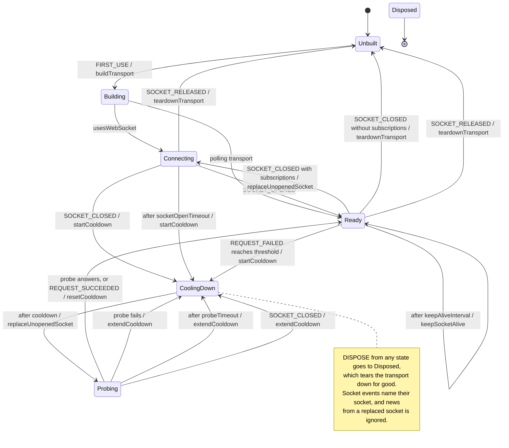

Five endpoint faults within 30 seconds start a 15 second cooldown. A failed
or timed-out probe doubles it, up to two minutes. Only faults count:
outages, rate limits, invalid responses, and 401 or 403. Reverts and other
4xx responses are about the request. A socket that isn't open is replaced on
the way into `Probing`, so a socket stuck connecting gets a successor. The
probe and the socket-open timeout run on the actor's clock.

Servers close a socket that is quiet for a minute. While a socket carries
`eth_subscribe` subscriptions, its endpoint sends `eth_chainId` on it every
30 seconds, on the actor's clock, which stops when the endpoint leaves
`Ready` or is disposed. A socket without subscriptions that closes is opened
again only when the endpoint is next used, so an unused one isn't reopened
every minute. `releaseSocket`, called when subscriptions move off an
endpoint, does the same for a ready or connecting endpoint, and only closes
the socket of a cooling or probing one.

`Endpoint` reports `CoolingDown`, `Probing` and recovery to metrics as
`open`, `half-open` and `closed`.

### Pool preference

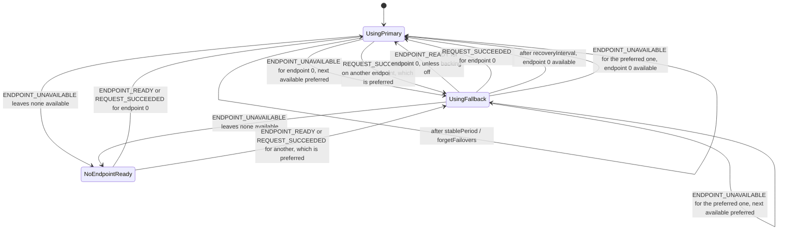

A pool prefers wherever a request last succeeded, so a request that had to
fail over to succeed moves the pool with it. A pool on a fallback checks
whether the primary can take requests again after a wait that grows with
each failover that comes within five minutes (`PRIMARY_STABLE_PERIOD_MS`)
of going back: 10 seconds, then 30, then 2 minutes, then 10 minutes from
then on (`PRIMARY_RECOVERY_INTERVALS_MS`). Five minutes on the primary
forgets the failovers. While the wait is longer than the first, the
primary becoming ready doesn't end it, so a primary that fails a request
every minute no longer pulls the pool, and its subscriptions, back and
forth every minute. A request that comes round to the primary, or a
fallback that becomes unavailable, still moves the pool back at once. Each
change of preference is emitted as `preferredEndpointChanged`.

## A request

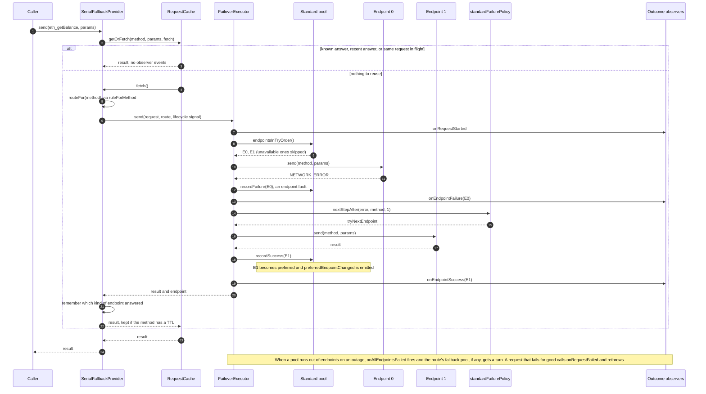

An invalid response is tried up to four times on the same endpoint, with a
400 to 800 ms backoff between tries. A 4xx other than 401 or 403 gives up at
once. When the provider is
destroyed, requests in flight reject with its destroyed error.

`TahoRPCProvider` batches HTTP requests, ten at a time by default. When an
endpoint refuses a batch as too large it halves the batch size, and resends
only the refused requests, so answered ones, broadcasts included, aren't sent
twice.

Transfer scans without Alchemy's API (`lib/erc20-transfer-logs.ts`) fit
their `eth_getLogs` ranges to the endpoint. An error that names the widest
range allowed (`rpc/log-query-errors.ts`) splits the range into chunks of
that size, and the provider remembers it for the rest of the session, so
later scans start there. A suggested range is used for that request only.
Otherwise a refused range is halved, down to 100 blocks. Pruned history,
such as Boar's code 4444 "earliest available N", sets a floor the same way:
the range starts at the earliest block kept, later scans don't ask below
it, and a range entirely below it is `LogHistoryUnavailableError`, where
`AssetTransferScanner` stops the backwards scan. Without an earliest block,
the range asked for is the floor. Range refusals and pruned history are
about the request, so they aren't endpoint faults; pruned history moves on
to the next endpoint, which may keep more.

ERC-721 `Transfer` shares ERC-20's topic hash, with the token ID as a
fourth topic, so the same queries find NFT transfers. Logs with three
topics are ERC-20 transfers and logs with four are ERC-721 ones. With
`SUPPORT_NFT_INDEXER` on, Alchemy-capable networks add the `erc721`
category to the transfer call they already make. The scanner emits
ERC-721 transfers as `nftTransfers`, without queueing transaction
lookups, and `NFTsService` indexes them (`lib/nft-indexer`).

That call returns 25 transfers, shared with ERC-20 ones, and other
networks' transfer scans cover only the blocks they're asked for, so with
the flag on `NFTLogScanner` scans ERC-721 logs over each account's whole
history on every network the indexer covers. It keeps only four-topic
logs, so ERC-20 transfers still come from the transfer scans. Without
Alchemy's API, an account's scan queues every block from genesis to the
head. With it, an account's scan starts by reporting up to three pages
each way of Alchemy's ERC-721 transfers, a thousand to a page, which is a
handful of requests against the thousands of `eth_getLogs` ones the same
history takes. It then queues the blocks from the account's first
incoming transfer, which Alchemy finds with one request, to the head;
an account that never received anything scans new blocks only.

The log scan fills what the pages didn't reach first. Pages run newest
first, so when a direction's pages stop at the cap, blocks from the first
transfer up to the oldest block they reached are queued first, that block
included since a page can end partway through it. Steps query both
directions, so the queue takes whichever direction reached less far. The
blocks the pages covered are queued after it, as a check that costs
nothing until the rest is done. When both directions' pages ran out, they
held every transfer and only new blocks are scanned. When the pages failed
or reached nothing, the whole history is queued, newest first.

The `nftTransferLogs` alarm ticks once a minute. A tick takes up to five
steps per chain, shared by its accounts in turn, and stops after 20
seconds. A step is two `eth_getLogs` requests over the newest 10,000
pending blocks, Boar's cap, or the narrower range the endpoints taught
the provider. Once the range is known, a chain gets at most ten
`eth_getLogs` requests a minute, however many accounts it has, and
mainnet's 24 million blocks take about eight hours of ticks for one
account. Chains with faster blocks, such as Arbitrum, take far longer,
which is what the Alchemy pages and the first transfer are for; without
them, the whole chain is scanned at the same pace. New
blocks are queued ahead of older history. A tick starts at most one new
account per chain, and doesn't run while the chain is unreachable or
`canServeNow("eth_getLogs")` says Boar is cooling down, so it never
probes Boar. Refused ranges and pruned history aren't endpoint faults,
so they don't cool Boar down either. A failed step ends the chain's tick
and is retried next tick; pruned history ends the scan at the earliest
block kept. Each account's cursor, in
`nftLogScanCursors` keyed by chain and account, holds the newest block
reached and the ranges left in the order they're scanned, and is saved with the tick's
transfers at the end of the tick, so a restart repeats at most one tick.

The ledger keys each transfer by chain, account, contract, token,
lowercased transaction hash and log index, so a transfer both sources
report is one entry, and `ownerOf` still decides what the account holds.

### Logging and errors

Each endpoint has a label naming its chain, kind, place in the walk and
host, such as `chain 8453 standard[1] base-mainnet.g.alchemy.com`
(`rpc/endpoint-label.ts`). Labels, and the errors described in the lines
below, keep only a URL's host, since paths and queries can hold API keys.

`loggingObserver` logs each failed attempt and what follows it at debug. A
request that fails for good gets one line: at warn when its endpoints were
at fault, naming any pools it ran out of, and at debug when the error was
the request's own, such as a revert, unless the failed attempt's line
already said it gave up. The executor logs a fallback to the
route's next pool, and skipping or probing a cooling endpoint. An endpoint
warns once when it starts cooling down, logs its probes and longer
cooldowns at debug, and its recovery, with how long it was down, at info;
pools log changes of preference; `ProviderRegistry` logs reachability changes and provider
swaps. Callers log a failure where they handle it, once: a failed
transfer scan is logged by `AssetTransferScanner`, with its chain, account
and block range, and not by `AssetDataHelper` or `ChainService`.

An error the executor rethrows carries `rpcContext`: the chain ID, the
method and the label of the last endpoint tried. Its message, `code` and
identity are unchanged, since callers and ethers match on them and some
messages reach the user. An abort's reason, such as the destroyed error, is
left alone.

## Subscriptions

`SerialFallbackProvider.on`, `once`, `off` and `subscribe` go to its
`SubscriptionManager`, which keeps them on one endpoint's transport: the
standard pool's preferred endpoint. When the pool's preference changes, the
provider moves them. `eth_subscribe` subscriptions wait while the endpoint is
a polling one.

Moves run one at a time, in order, and never reject. A move waits for its
endpoint to be ready, attaches the ethers listeners, then replays each
WebSocket subscription; one the endpoint refuses is logged and the rest
carry on. A subscription refused on its first try is forgotten. If the
endpoint cools down before it's ready, the move fails, and the manager
finishes it once the endpoint becomes ready. It also follows its endpoint
onto a new socket after a reconnect. A cleared manager, which is what a
destroyed provider has, makes no more moves.

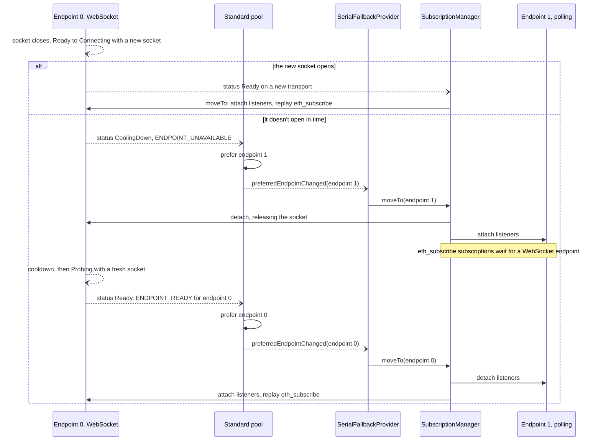

`onPendingTransaction` subscribes to `alchemy_pendingTransactions` and falls
back to the `pending` event, looking each hash up, where the endpoint says
the method is unsupported.

## Reachability

`NetworkReachabilityTracker` is a plain class, fed by `reachabilityObserver`.
Cached answers never count.

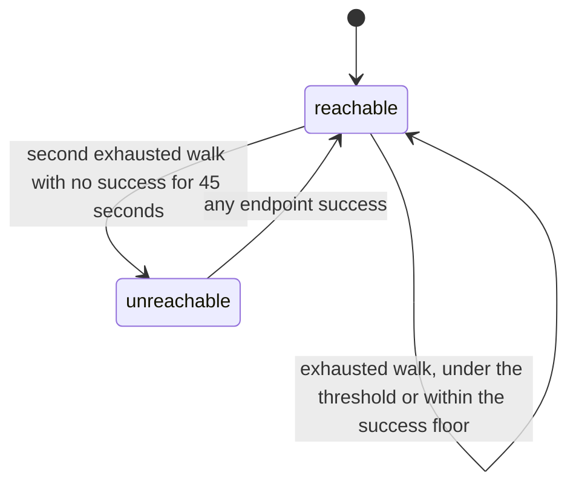

The provider reports changes to its chain actor, naming itself. The chain
machine only takes reports from its current provider that change the
chain's reachability, so a retired provider can't speak for the chain, and a
report is emitted once. A new provider starts out reachable. `ChainService`
passes each change to the network watch and emits `networkReachability`.

## Chain lifecycle

`ProviderRegistry.start` builds a chain's actor, whose entry builds the
provider. If building throws, for instance because the chain has no
endpoints to walk, `start` logs, forgets the chain and rethrows, which fails
service startup.

`updateEndpoints` checks and saves a list before swapping, and
`replaceProvider` swaps in a provider for endpoints already saved. Both take
stored `RpcEndpoint[]`; the registry's `createProvider` dependency turns them
into endpoint configs. `removeProvider` destroys the provider and deletes
the chain's rows.

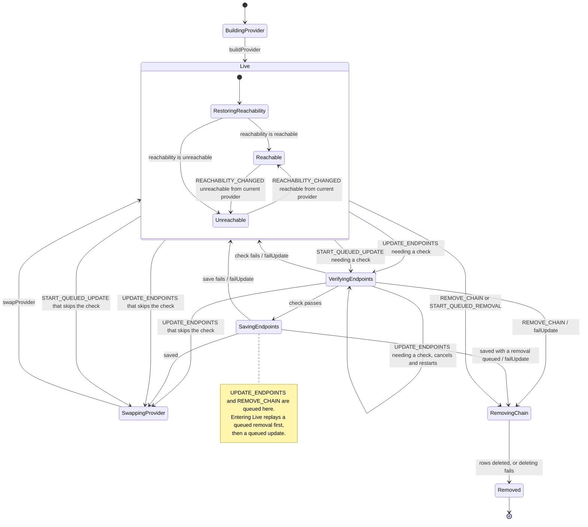

- Reachability is kept in context rather than in a history state.
  `RestoringReachability` puts a chain back in the state it was in after a
  failed update; only a swap resets it to reachable.
- An update needing a check that replaces another one cancels its check and
  takes over its callers, last writer wins. An update that skips the check,
  such as `addCustomChain` re-adding a chain, rejects the update it replaces
  with `EndpointUpdateSupersededError`, since that list was never saved; the
  settings form reports it as a failed save. Queued updates fold together the
  same way, and one needing a check that joins a queued check-free one makes
  it take the stricter path.
- A removal requested while saving waits for the save, then goes straight to
  `RemovingChain` without building or announcing a provider.
- `swapProvider` builds the new provider before destroying the old one, then
  emits `providerReplaced` and `reachabilityChanged` reachable.
- `RemovingChain` destroys the provider on entry and rejects updates and
  queued updates with `ChainRemovedError`.

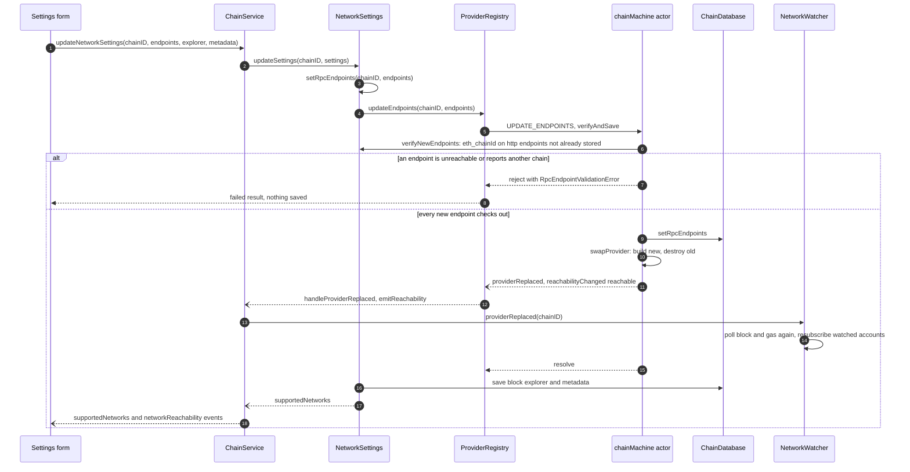

## Watching networks

`NetworkWatcher.watchNetwork` starts a network's watch actor and resolves
once its first block poll is done; `ChainService` emits `networkSubscribed`
after that. Block and gas polls look the provider up each time, so a
replaced provider needs only a fresh poll and new pending-transaction
subscriptions for the network's accounts.

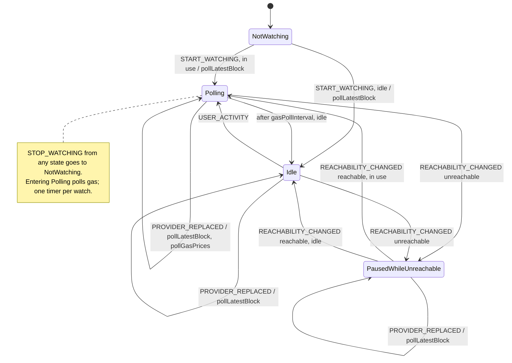

A network is in use for 2.05 minutes after activity on it. Gas is polled
every 15 seconds while it's in use and reachable. Extension alarms only wake
the service worker.

## Transaction tracking

`TransactionTracker` keeps an in-memory, prioritized lookup queue and looks
one transaction up every two seconds. Pending rows are queued again from
IndexedDB on startup, as are rows first seen within the lookup lifetime that
have a block but no receipt. One lookup runs at a time per transaction.

A lookup rebuilds the transaction's state from its stored row with
`pendingTransactionStateFor`, applies events with
`nextPendingTransactionState`, and carries out the effects the machine
returns: saving, persisting or clearing `missingSince`, requeueing,
observing nonces, watching for receipts, fetching the block and receipt,
marking dropped or expired, releasing the nonce, unwatching and dequeueing.
The machine itself decides nothing else, and state lives in IndexedDB, so it
survives service worker restarts.

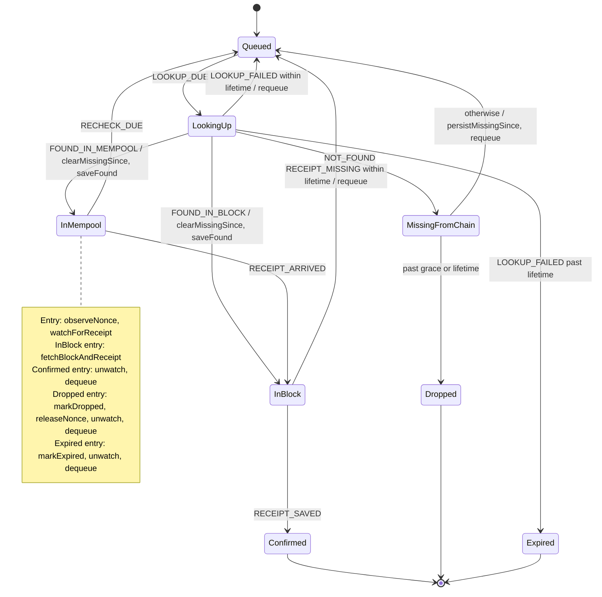

### The drop rule

A transaction counts as dropped only after lookups have found nothing for
longer than a grace period: two minutes on chains without a public mempool,
fifteen on chains with one (`CHAINS_WITH_MEMPOOL`). The first miss sets
`missingSince`, on the row and on the queued lookup, so the grace survives a
restart. Any save from the chain, as opposed to a local one, clears it. A
miss past the ten-hour lookup lifetime drops the transaction even inside the
grace. A lookup that fails outright, or fails after finding the transaction,
is retried within the lifetime and expires after it; expiry keeps the
nonce.

Marking a transaction dropped reads its row again first, and neither marks
it nor releases its nonce if a receipt landed in the meantime.

Receipts also arrive through `watchForReceipt`, which listens once per hash
per provider and queues a lookup with the transaction's real `firstSeen`.

## How ChainService composes the parts

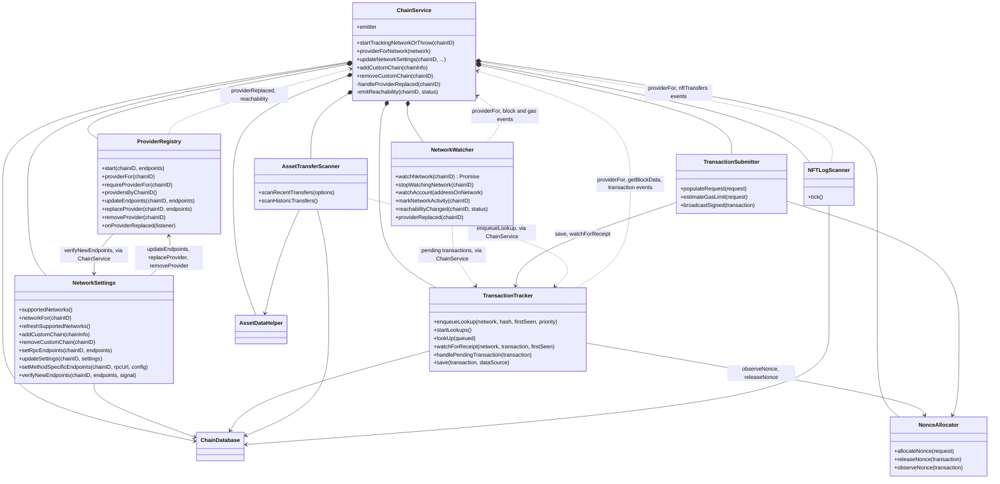

The parts don't hold each other, apart from `NetworkSettings` holding the
registry and the submitter holding the tracker and allocator. `ChainService`
passes each part callbacks, such as `providerFor`, `emitTransaction` or
`enqueueTransactionLookup`, so each can be tested with plain fakes.

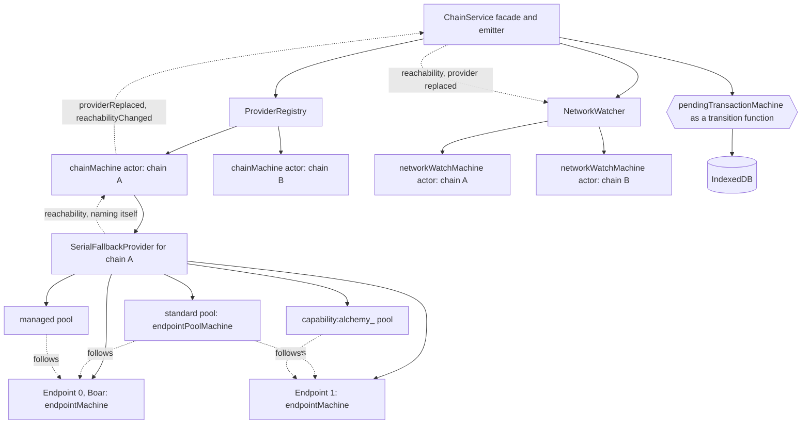

## Edge behaviour

- Boar's health is shared between the walk and the `managed` pool, since
  both use the same `Endpoint`.
- A request that succeeds on a cooling endpoint, sent by a single-endpoint
  pool, doesn't end the cooldown; only the endpoint's own probe does.
- A WebSocket subscription that an endpoint refuses during a move stays
  tracked and is retried, and logged, on every later move.
- If any chain's provider can't be built, service startup fails, so one bad
  custom chain blocks every chain.
- `ProviderRegistry` and `NetworkWatcher` key their maps by decimal chain ID.
  Other maps, such as the method-specific endpoint configs and the chain
  service's tracked chain IDs, key by the ID as given.
- A mined transaction whose receipt hasn't come in by the end of the lookup
  lifetime stays pending and isn't queued again.
- Endpoint health and reachability live in memory and reset when the service
  worker restarts.
- WebSocket endpoints are saved without an `eth_chainId` check.

## Tests

`createChainService` in `background/tests/factories.ts` builds the service
with `ChainService.createWithDependencies`, handing it a mock provider and,
when a test asks, a stand-in gas price lookup, so tests never reach a real
endpoint. The test scripts run with `--parallel`, which gives each file a
fresh global and module registry (bun's `--isolate`), but each file also
cleans up after itself and passes in a shared process.
