# Chain service architecture

How the chain service and its RPC provider stack fit together.

Everything here lives under `background/services/chain/`. Paths below are
relative to it.

## The parts

### Chain service

| Component                   | File                             | Owns                                                                                                                                                                                             |
| --------------------------- | -------------------------------- | ------------------------------------------------------------------------------------------------------------------------------------------------------------------------------------------------ |
| `ChainService`              | `index.ts`                       | The service facade and its event emitter. Builds the parts below, passes each the callbacks it needs, and keeps the list of tracked networks and accounts.                                       |
| `ProviderRegistry`          | `provider-registry.ts`           | One `chainMachine` actor per chain, keyed by decimal chain ID. The only place providers are created, replaced or destroyed.                                                                      |
| `chainMachine`              | `chain-machine.ts`               | One chain's provider, endpoint list and reachability, and the order in which endpoint updates and removal happen.                                                                                |
| `NetworkSettings`           | `network-settings.ts`            | Supported networks, custom chains, stored RPC endpoints, method-specific endpoints and block explorers. Checks new endpoints with `eth_chainId` before they are saved.                           |
| `NetworkWatcher`            | `network-watcher.ts`             | One `networkWatchMachine` actor per watched network, the watched accounts, and network and address activity times. Polls latest blocks and gas, and subscribes accounts to pending transactions. |
| `networkWatchMachine`       | `network-watch-machine.ts`       | When a network's block and gas polls run.                                                                                                                                                        |
| `TransactionTracker`        | `transaction-tracker.ts`         | The lookup queue and the steps that follow a transaction until it confirms, drops or expires.                                                                                                    |
| `pendingTransactionMachine` | `pending-transaction-machine.ts` | Pure decisions about a transaction's lifecycle, run as a transition function over the stored row.                                                                                                |
| `TransactionSubmitter`      | `transaction-submitter.ts`       | Populating requests, estimating gas, and broadcasting signed transactions.                                                                                                                       |
| `NonceAllocator`            | `nonce-allocator.ts`             | Nonces for outgoing transactions, per address and chain.                                                                                                                                         |
| `AssetTransferScanner`      | `asset-transfer-scanner.ts`      | Recent and historic asset transfer scans, which queue lookups for transactions they find.                                                                                                        |
| `AssetDataHelper`           | `asset-data-helper.ts`           | Token balances and transfers, from Alchemy methods or logs.                                                                                                                                      |
| `ChainDatabase`             | `db.ts`                          | IndexedDB: networks, endpoints, transactions, blocks, balances.                                                                                                                                  |

### RPC provider stack

| Component                    | File                               | Owns                                                                                                                                                                        |
| ---------------------------- | ---------------------------------- | --------------------------------------------------------------------------------------------------------------------------------------------------------------------------- |
| `SerialFallbackProvider`     | `serial-fallback-provider.ts`      | The ethers-compatible facade for one chain. Builds the endpoints and pools, routes requests, and holds the subscription manager, reachability tracker and lifecycle signal. |
| `RequestCache`               | `rpc/request-cache.ts`             | Known answers (`eth_chainId`), short-lived recent answers, and coalescing of identical requests in flight.                                                                  |
| Method router                | `rpc/method-router.ts`             | `routeRulesFor` and `ruleForMethod`: which pool a method goes to, and its fallback pool.                                                                                    |
| `FailoverExecutor`           | `rpc/failover-executor.ts`         | Walks a route's pools and their endpoints for one request, following a failure policy. All retry state lives in this loop.                                                  |
| Failure policies             | `rpc/failure-policy.ts`            | `standardFailurePolicy` and `anyErrorFailsOverPolicy`, and which errors are an endpoint's fault or an outage.                                                               |
| `EndpointPool`               | `rpc/endpoint-pool.ts`             | An ordered set of endpoints and which one requests start from, through `endpointPoolMachine` (`rpc/endpoint-pool-machine.ts`).                                              |
| `Endpoint`                   | `rpc/endpoint.ts`                  | One configured endpoint's lazily built transport and its health, through `endpointMachine` (`rpc/endpoint-machine.ts`).                                                     |
| `SubscriptionManager`        | `rpc/subscription-manager.ts`      | ethers listeners and `eth_subscribe` subscriptions, kept on one endpoint's transport and moved when told to.                                                                |
| Outcome observers            | `rpc/request-outcome-observers.ts` | Feed request outcomes to the reachability tracker and to performance metrics.                                                                                               |
| `NetworkReachabilityTracker` | `network-reachability.ts`          | Whether the chain can be reached at all, from exhausted walks and successes.                                                                                                |
| Endpoint configs             | `rpc/endpoint-configs.ts`          | Turns stored endpoints, Boar's URL, method-specific endpoints and fork overrides into `EndpointConfig`s.                                                                    |
| `TahoRPCProvider`            | `taho-rpc-provider.ts`             | The batching HTTP transport. Shrinks batches an endpoint finds too large and resends only the refused requests.                                                             |

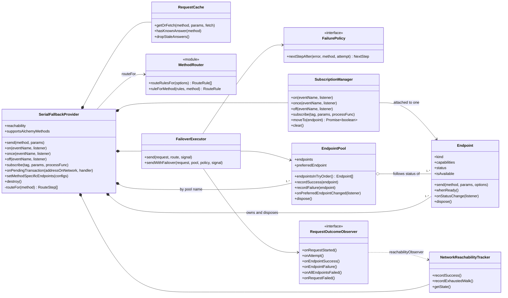

## Endpoints, pools and routes

A provider builds one `Endpoint` per configured endpoint. The walk's endpoints
are, in order, Boar (`managed`) when the chain has it, then the stored
endpoints (`standard`). Method-specific endpoints, such as Flashbots, sit
outside the walk.

Endpoints are shared between pools rather than owned by them; the provider
owns and disposes them. Each pool subscribes to its endpoints' status and
keeps its own preference. The pools are:

- `standard`: the whole walk.
- `managed`: Boar alone.
- `capability:<namespace>`: standard endpoints that declare a namespace, such
  as `alchemy_`.
- `methodSpecific`: the method-specific endpoints, replaced whole by
  `setMethodSpecificEndpoints`.

`routeRulesFor` turns these into rules, most specific first:
method-specific methods, then capability namespaces (falling back to
`managed` when Boar also serves the namespace), then methods pinned to Boar
(`eth_sendRawTransaction`, `eth_subscribe`, `eth_estimateGas`, `eth_getLogs`,
`alchemy_`, and `eth_call` on Optimism and Arbitrum), then the standard walk.
`standard` and `managed` use `standardFailurePolicy`; the others move on after
any error.

An endpoint is available while `Unbuilt`, `Connecting` or `Ready`.
`endpointsInTryOrder` starts from the pool's preferred endpoint, wraps
around, and skips unavailable endpoints. A pool whose only endpoint is
cooling down still tries it, as a probe, so Boar's methods aren't refused
outright while failures elsewhere have Boar cooling down. A pool of several
keeps skipping cooling endpoints, so the standard walk stays off a cooling
Boar.

`Endpoint.send` refuses requests with `NoEndpointAvailableError` while the
endpoint is cooling down or probing, unless they're probes, and waits for a
WebSocket that is still connecting.

### Endpoint health

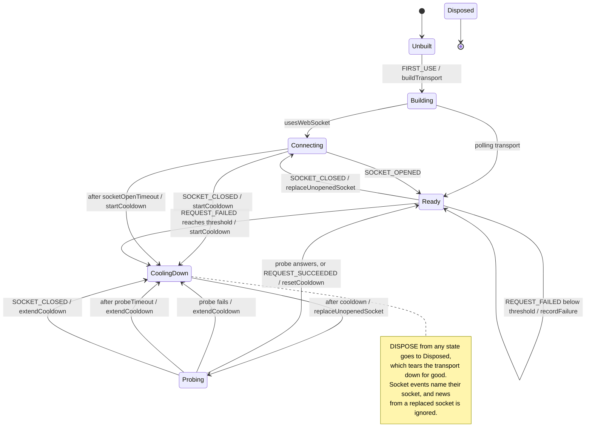

Five endpoint faults within 30 seconds start a 15 second cooldown. A failed
or timed-out probe doubles it, up to two minutes. Only faults count:
outages, rate limits, invalid responses, and 401 or 403. Reverts and other
4xx responses are about the request. A socket that isn't open is replaced on
the way into `Probing`, so a socket stuck connecting gets a successor. The
probe and the socket-open timeout run on the actor's clock.

`Endpoint` reports `CoolingDown`, `Probing` and recovery to metrics as
`open`, `half-open` and `closed`.

### Pool preference

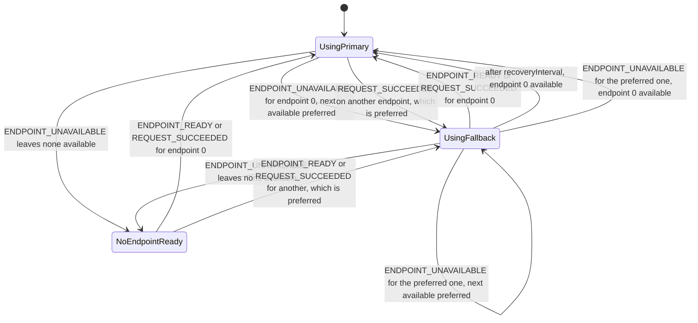

A pool prefers wherever a request last succeeded, so a request that had to
fail over to succeed moves the pool with it. Every 10 seconds
(`PRIMARY_RECOVERY_INTERVAL_MS`) a pool on a fallback checks whether the
primary can take requests again. Each change of preference is emitted as
`preferredEndpointChanged`.

## A request

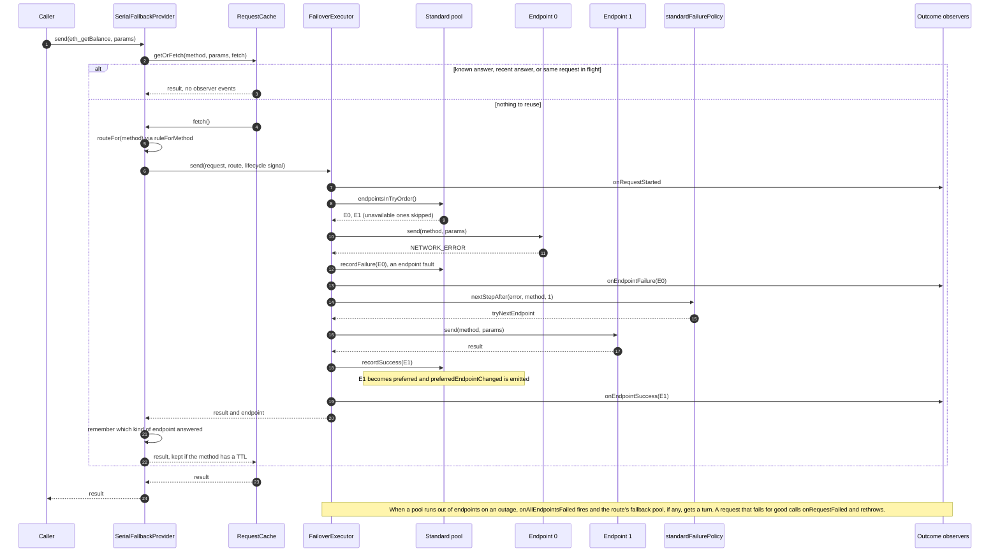

An invalid response is tried up to four times on the same endpoint, with a
400 to 800 ms backoff between tries. A 4xx other than 401 or 403 gives up at
once. When the provider is
destroyed, requests in flight reject with its destroyed error.

`TahoRPCProvider` batches HTTP requests, ten at a time by default. When an
endpoint refuses a batch as too large it halves the batch size, and resends
only the refused requests, so answered ones, broadcasts included, aren't sent
twice.

## Subscriptions

`SerialFallbackProvider.on`, `once`, `off` and `subscribe` go to its
`SubscriptionManager`, which keeps them on one endpoint's transport: the
standard pool's preferred endpoint. When the pool's preference changes, the
provider moves them. `eth_subscribe` subscriptions wait while the endpoint is
a polling one.

Moves run one at a time, in order, and never reject. A move waits for its
endpoint to be ready, attaches the ethers listeners, then replays each
WebSocket subscription; one the endpoint refuses is logged and the rest
carry on. A subscription refused on its first try is forgotten. If the
endpoint cools down before it's ready, the move fails, and the manager
finishes it once the endpoint becomes ready. It also follows its endpoint
onto a new socket after a reconnect. A cleared manager, which is what a
destroyed provider has, makes no more moves.

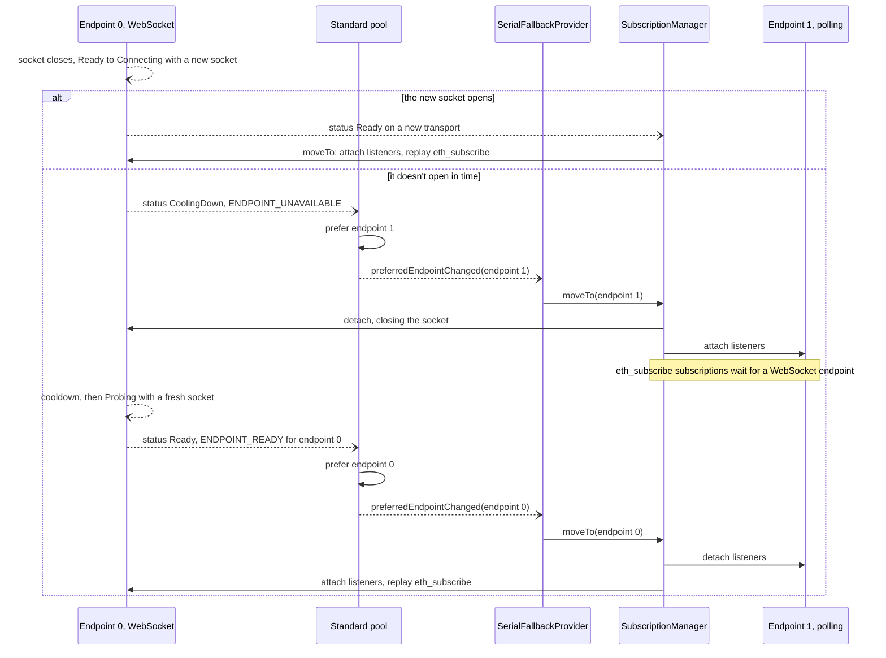

`onPendingTransaction` subscribes to `alchemy_pendingTransactions` and falls
back to the `pending` event, looking each hash up, where the endpoint says
the method is unsupported.

## Reachability

`NetworkReachabilityTracker` is a plain class, fed by `reachabilityObserver`.
Cached answers never count.

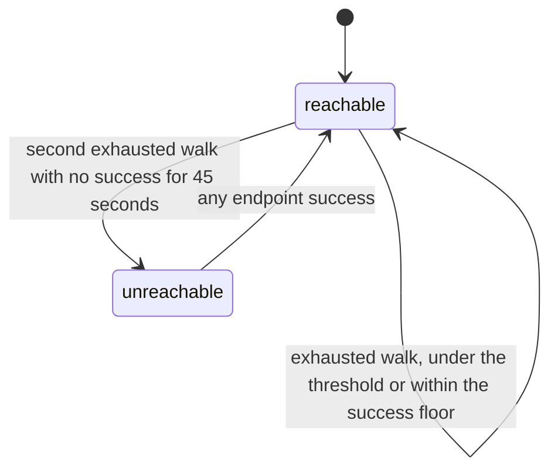

The provider reports changes to its chain actor, naming itself. The chain
machine only takes reports from its current provider that change the
chain's reachability, so a retired provider can't speak for the chain, and a
report is emitted once. A new provider starts out reachable. `ChainService`
passes each change to the network watch and emits `networkReachability`.

## Chain lifecycle

`ProviderRegistry.start` builds a chain's actor, whose entry builds the
provider. If building throws, for instance because the chain has no
endpoints to walk, `start` logs, forgets the chain and rethrows, which fails
service startup.

`updateEndpoints` checks and saves a list before swapping, and
`replaceProvider` swaps in a provider for endpoints already saved. Both take
stored `RpcEndpoint[]`; the registry's `createProvider` dependency turns them
into endpoint configs. `removeProvider` destroys the provider and deletes
the chain's rows.

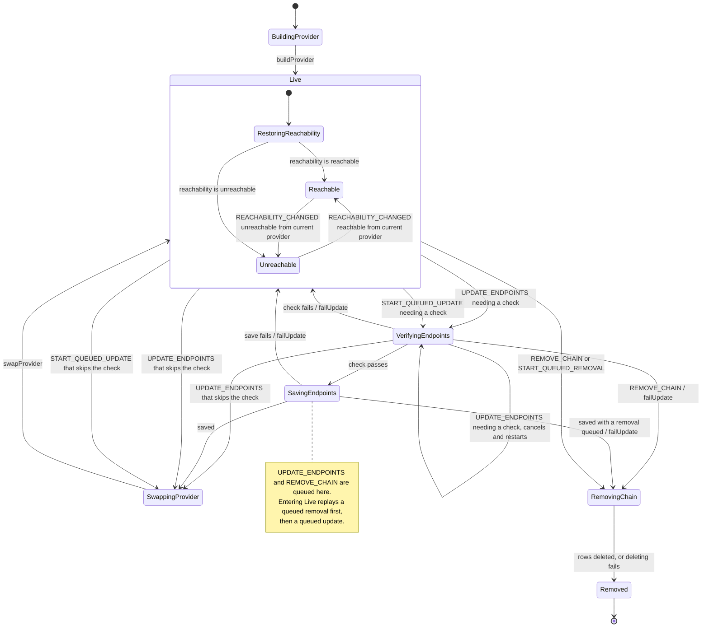

- Reachability is kept in context rather than in a history state.
  `RestoringReachability` puts a chain back in the state it was in after a
  failed update; only a swap resets it to reachable.
- An update needing a check that replaces another one cancels its check and
  takes over its callers, last writer wins. An update that skips the check,
  such as `addCustomChain` re-adding a chain, rejects the update it replaces
  with `EndpointUpdateSupersededError`, since that list was never saved; the
  settings form reports it as a failed save. Queued updates fold together the
  same way, and one needing a check that joins a queued check-free one makes
  it take the stricter path.
- A removal requested while saving waits for the save, then goes straight to
  `RemovingChain` without building or announcing a provider.
- `swapProvider` builds the new provider before destroying the old one, then
  emits `providerReplaced` and `reachabilityChanged` reachable.
- `RemovingChain` destroys the provider on entry and rejects updates and
  queued updates with `ChainRemovedError`.

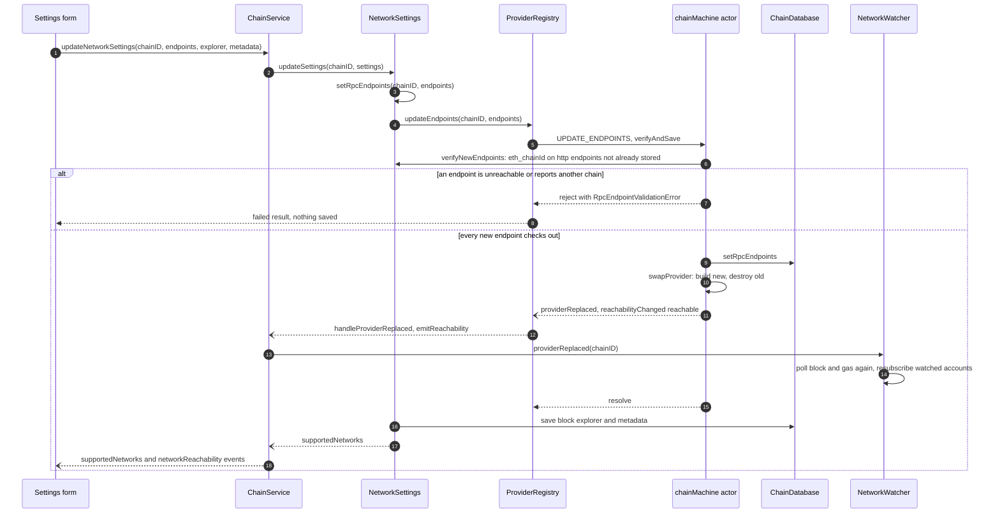

## Watching networks

`NetworkWatcher.watchNetwork` starts a network's watch actor and resolves
once its first block poll is done; `ChainService` emits `networkSubscribed`
after that. Block and gas polls look the provider up each time, so a
replaced provider needs only a fresh poll and new pending-transaction
subscriptions for the network's accounts.

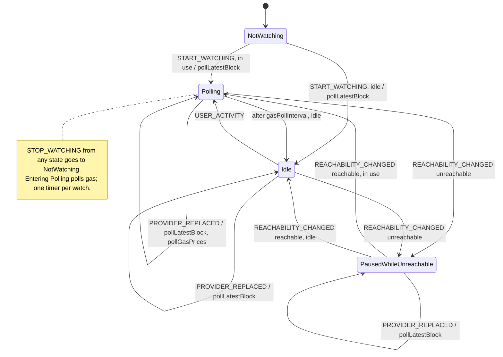

A network is in use for 2.05 minutes after activity on it. Gas is polled
every 15 seconds while it's in use and reachable. Extension alarms only wake
the service worker.

## Transaction tracking

`TransactionTracker` keeps an in-memory, prioritized lookup queue and looks
one transaction up every two seconds. Pending rows are queued again from
IndexedDB on startup, as are rows first seen within the lookup lifetime that
have a block but no receipt. One lookup runs at a time per transaction.

A lookup rebuilds the transaction's state from its stored row with
`pendingTransactionStateFor`, applies events with
`nextPendingTransactionState`, and carries out the effects the machine
returns: saving, persisting or clearing `missingSince`, requeueing,
observing nonces, watching for receipts, fetching the block and receipt,
marking dropped or expired, releasing the nonce, unwatching and dequeueing.
The machine itself decides nothing else, and state lives in IndexedDB, so it
survives service worker restarts.

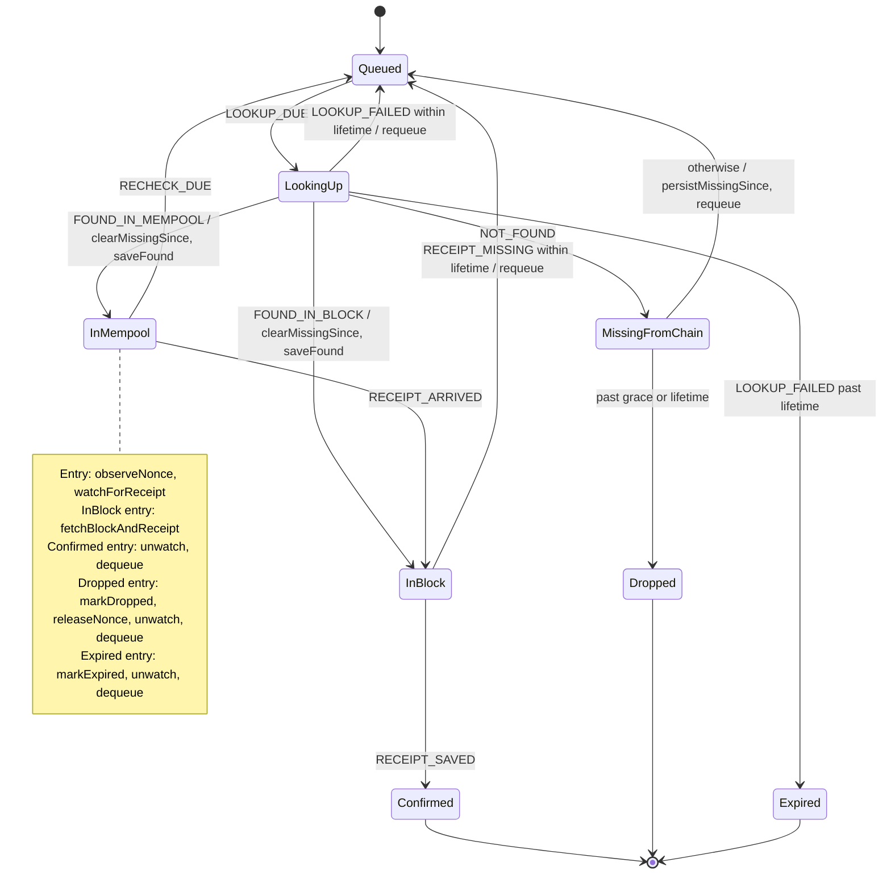

### The drop rule

A transaction counts as dropped only after lookups have found nothing for
longer than a grace period: two minutes on chains without a public mempool,
fifteen on chains with one (`CHAINS_WITH_MEMPOOL`). The first miss sets
`missingSince`, on the row and on the queued lookup, so the grace survives a
restart. Any save from the chain, as opposed to a local one, clears it. A
miss past the ten-hour lookup lifetime drops the transaction even inside the
grace. A lookup that fails outright, or fails after finding the transaction,
is retried within the lifetime and expires after it; expiry keeps the
nonce.

Marking a transaction dropped reads its row again first, and neither marks
it nor releases its nonce if a receipt landed in the meantime.

Receipts also arrive through `watchForReceipt`, which listens once per hash
per provider and queues a lookup with the transaction's real `firstSeen`.

## How ChainService composes the parts

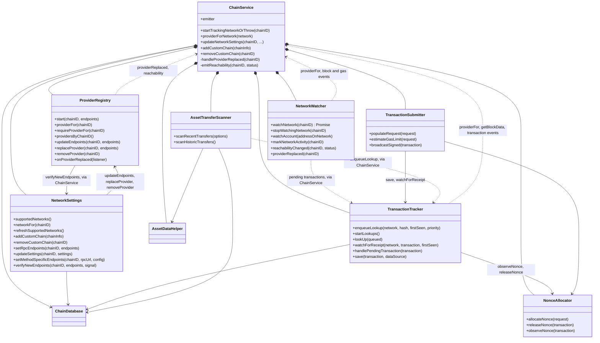

The parts don't hold each other, apart from `NetworkSettings` holding the
registry and the submitter holding the tracker and allocator. `ChainService`
passes each part callbacks, such as `providerFor`, `emitTransaction` or
`enqueueTransactionLookup`, so each can be tested with plain fakes.

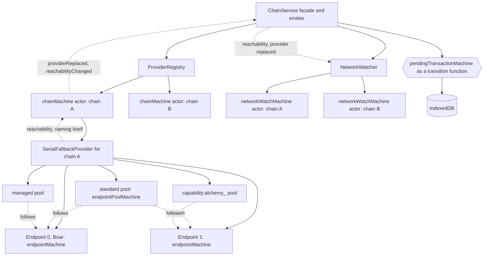

## Edge behaviour

- Boar's health is shared between the walk and the `managed` pool, since
  both use the same `Endpoint`.
- A request that succeeds on a cooling endpoint, sent by a single-endpoint
  pool, doesn't end the cooldown; only the endpoint's own probe does.
- A WebSocket subscription that an endpoint refuses during a move stays
  tracked and is retried, and logged, on every later move.
- If any chain's provider can't be built, service startup fails, so one bad
  custom chain blocks every chain.
- `ProviderRegistry` and `NetworkWatcher` key their maps by decimal chain ID.
  Other maps, such as the method-specific endpoint configs and the chain
  service's tracked chain IDs, key by the ID as given.
- A mined transaction whose receipt hasn't come in by the end of the lookup
  lifetime stays pending and isn't queued again.
- Endpoint health and reachability live in memory and reset when the service
  worker restarts.
- WebSocket endpoints are saved without an `eth_chainId` check.

## Tests

`background/tests/factories.ts` replaces `serial-fallback-provider` with a
mock through `mock.module`, which bun applies to the whole process and can't
undo. The provider's integration tests fail when run in the same bun process
as a test that imports the factories, so the test scripts run each
integration file in its own process.
